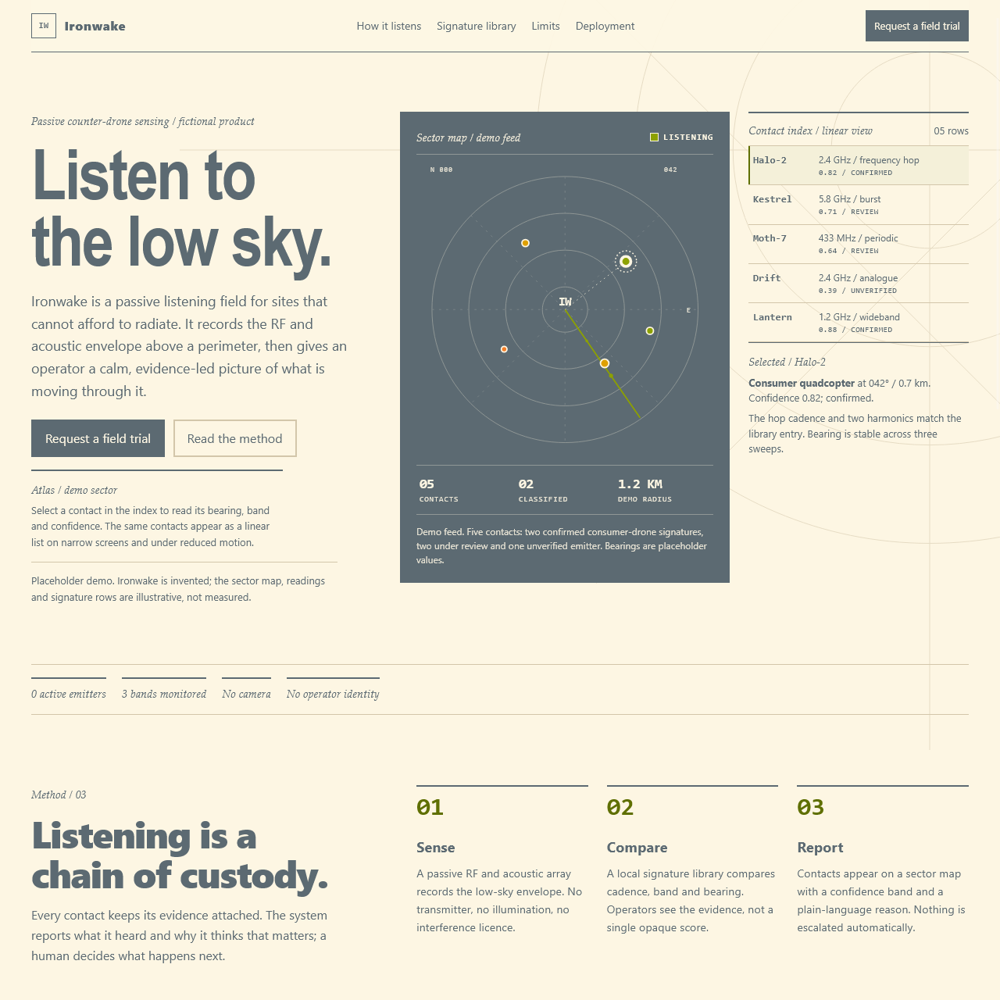
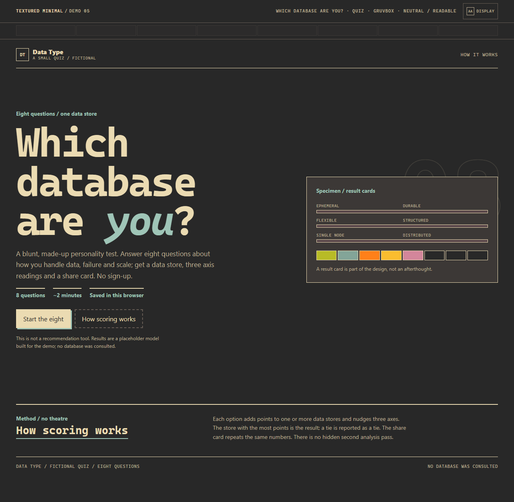
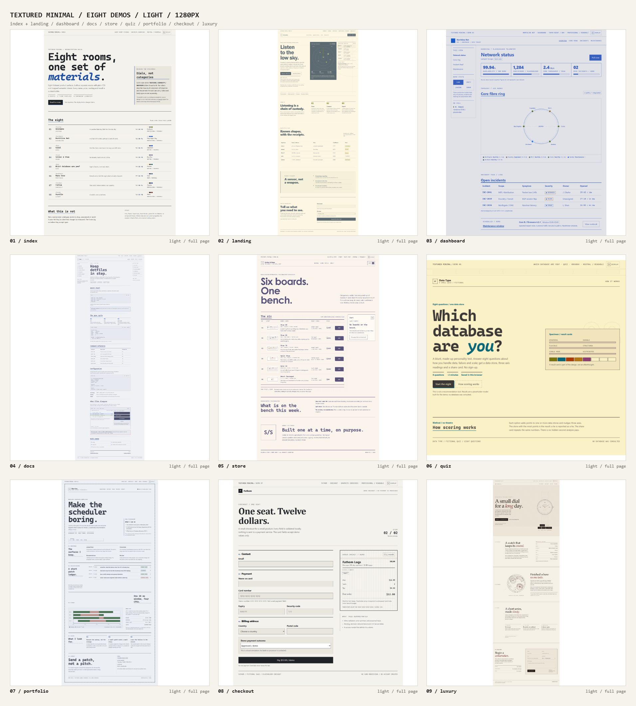
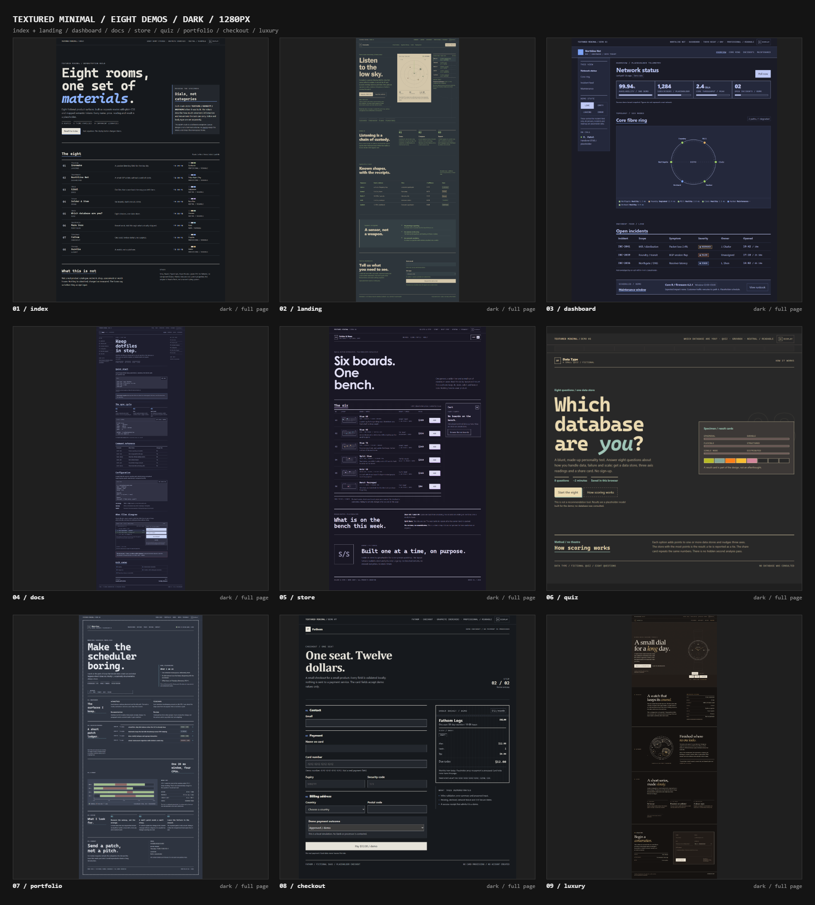

# minimalist-ui

An agent skill for creating textured-minimal interfaces: clear layouts, themed colors, purposeful details, accessible interactions, and optional generative texture. It guides websites and apps without requiring a particular framework or template.

<table>
  <tr>
    <td width="50%"></td>
    <td width="50%"></td>
  </tr>
  <tr>
    <td width="50%"></td>
    <td width="50%"></td>
  </tr>
</table>

## Install

```bash
npx skills add bremsstrahlung-57/minimalist-ui-skill
```

The skill supports three styles: `nerd` keeps terminal-inspired details, `neutral` tones them down, and `professional` uses a more conventional visual language. It can also use readable body text with monospace headings and labels.

## License

[MIT License](LICENSE) · Copyright (c) 2026 Sagar Sharma
